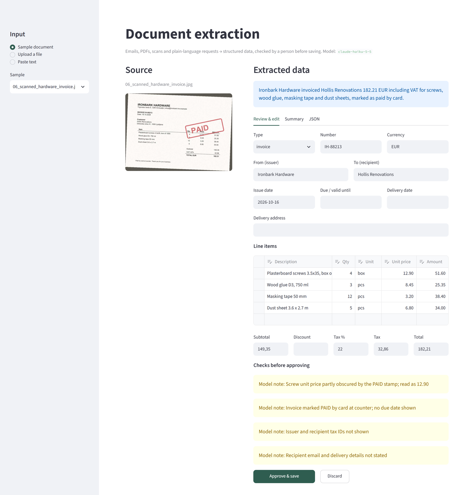
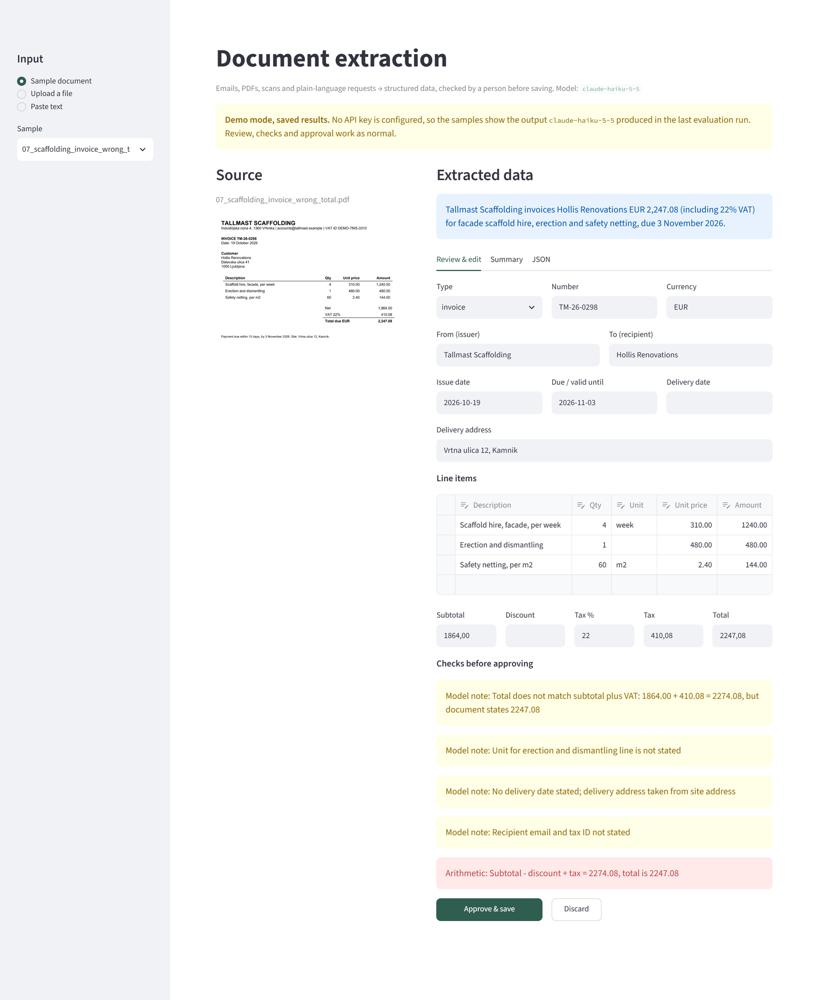

# Document extraction with human review

[](https://github.com/cesicobrad/doc-extraction/actions/workflows/ci.yml)

Turns messy business paperwork (forwarded emails, PDF invoices and orders, photos of paper
invoices, notes from a phone call) into structured JSON and a clean summary table. A person
checks and corrects the result before anything is saved.



## What it does

1. **Input:** pick a sample, upload a PDF, photo or scan (PNG/JPG), `.eml` or `.txt`, or
   paste text.
2. **Extract:** Claude reads the document and returns data that must match a fixed schema
   (structured outputs, validated with Pydantic). It covers parties, document number,
   dates, currency, line items, subtotal, discount, tax and total. PDFs and images go to
   the model as-is, so layout and tables are preserved, and no separate OCR step is needed.
3. **Review:** every field and line item can be edited. Two kinds of checks appear before
   approval:
   - **Model notes:** anything the model thinks a person should look at, e.g. *"site lead
     thinks the adhesive quantity may be too high"* or *"PAID stamp partly covers the
     price; value confirmed by the line total"*.
   - **Arithmetic checks:** deterministic code verifies quantity × price, the line item
     sum, tax at the stated rate, and the total. These re-run live as you edit.
4. **Approve & save:** the reviewed record is written to `data/approved/` as JSON, marked
   with whether the reviewer changed anything. Discard drops it.

Nothing is saved without a person approving it. The model proposes, the reviewer decides.

A wrong total on a supplier invoice is flagged by both the model and the code check:



## Try it without an API key

With no `ANTHROPIC_API_KEY` set, the app starts in **demo mode**: the bundled samples load
the results saved by the last evaluation run (clearly labelled as saved results), and the
review, checks and approve flow all work normally. Approved records are kept for the
browser session only. Uploads and pasted text need a key. This makes the app suitable for
free hosting on Streamlit Community Cloud. Add the key as a secret there to turn on live
extraction.

## Samples

Eight made-up documents from a renovation contractor's inbox, each with a different shape:

| File | What it is | What makes it awkward |
|---|---|---|
| `01_forwarded_quote.eml` | Tile supplier quote, forwarded internally | Forwarding header, signature and disclaimer around the real content; European number format |
| `02_concrete_invoice.pdf` | Ready-mix concrete invoice | DD/MM/YYYY dates, delivery date separate from issue date |
| `03_timber_purchase_order.pdf` | Purchase order sent to a timber yard | The contractor is the *issuer* here, not the recipient |
| `04_phone_order_note.txt` | Notes from a phone call | No prices, "Thursday this week" instead of a date, quantities written in words |
| `05_subcontractor_invoice.eml` | Electrician's invoice typed into an email | Informal, early-payment discount, `1.345,14 €` formatting |
| `06_scanned_hardware_invoice.jpg` | Phone photo of a paper invoice | Tilted, blurred, noisy JPEG; a red PAID stamp covers a price and a quantity |
| `07_scaffolding_invoice_wrong_total.pdf` | Scaffolding hire invoice | The stated total is wrong (digits transposed). The correct extraction keeps the stated figure, and the checks must flag it |
| `08_racun_slovenian.pdf` | Slovenian builder's invoice (*račun*) | Slovenian labels (*Osnova za DDV*, *Za plačilo*, *Rok plačila*), `12. 10. 2026` dates, `1.529,80` numbers, decimal quantities |

All companies, people, addresses, IDs and bank details are fictional. Email domains use
the reserved `.example` TLD. `scripts/make_samples.py` regenerates the PDFs and the photo.

## Evaluation

`eval/expected/` holds the correct values for each sample, written by hand. The eval
extracts every sample and checks 103 fields: document type, number, parties, dates,
currency, subtotal, discount, tax rate, tax, total, line item amounts and quantities, and
whether the arithmetic checks fire. They must fire on the wrong-total invoice and stay quiet
on the other seven.

Result with `claude-opus-5-5`:

```
01_forwarded_quote                     13/13
02_concrete_invoice                    14/14
03_timber_purchase_order               14/14
04_phone_order_note                     8/8
05_subcontractor_invoice               14/14
06_scanned_hardware_invoice            13/13
07_scaffolding_invoice_wrong_total     13/13
08_racun_slovenian                     14/14

Score: 103/103 fields correct (100%)
PASS
```

The run passes at 95% or above. Raw model outputs are saved in `eval/outputs/<model>/`, so
`--rescore` re-checks them without calling the API. CI does that on every push, together
with the unit tests.

### Model comparison

The same eval, one run per model, documents processed one at a time:

| Model | Accuracy | Avg time / doc | Avg tokens in / out | Approx. cost / doc |
|---|---|---|---|---|
| `claude-opus-5-5` | 103/103 (100%) | 7.2 s | 3,439 / 784 | $0.0294 |
| `claude-sonnet-5-5` | 103/103 (100%) | 4.7 s | 3,439 / 679 | $0.0137 |
| `claude-haiku-5-5` | 103/103 (100%) | 6.5 s | 3,439 / 1,358 | $0.0010 |

Cost = average tokens from the runs × published standard API prices per million tokens
(input / output): Opus 5.5 $4 / $20, Sonnet 5.5 $2 / $10, Haiku 5.5 $0.10 / $0.50
(Haiku's rate for prompts under 100K tokens; these are about 4K). Output tokens include the
model's internal reasoning. To recompute from the saved runs, use
`python eval/run_eval.py --compare`.

What the table does and doesn't show:

- **All three models got every field right, so this eval can't separate them on accuracy.**
  Eight documents is a small set. A real deployment should add the customer's own
  documents to `eval/expected/` before choosing.
- The models differed in their notes to the reviewer. On the wrong-total invoice, Opus and
  Haiku both explained the mismatch in their own words. Sonnet extracted the figures
  correctly but didn't mention it, and the code check caught it anyway. That's the reason
  the arithmetic check lives in code rather than in the prompt.
- Haiku produced about twice as many output tokens as the other two, which is why it isn't
  the fastest despite being the smallest model. Its per-token price is low enough that it
  is still about 13× cheaper than Sonnet and 29× cheaper than Opus.

**Recommendation:** `claude-haiku-5-5` as the default for this workload. On this eval it
matched the larger models on every field and its notes to the reviewer were as useful as
Opus's, at about a tenth of a cent per document. The trade-off is about two seconds more
per document than Sonnet. Haiku also has no server-side refusal fallback, and eight
documents is too few to rule out a gap on harder real-world paperwork. So choose Sonnet
when response time matters most, and re-run the eval on the customer's own documents
before committing. The code currently defaults to Opus. Switch with
`EXTRACTION_MODEL=claude-haiku-5-5` in `.env`, or pass `--model` to the eval.

## Run it

Requires Python 3.11+ and an [Anthropic API key](https://platform.claude.com/settings/keys)
(or none, for demo mode).

```bash
python -m venv .venv
.venv/Scripts/activate        # macOS/Linux: source .venv/bin/activate
pip install -r requirements.txt
cp .env.example .env          # then add your ANTHROPIC_API_KEY
streamlit run app.py
```

Tests and evaluation:

```bash
pip install -r requirements-dev.txt
pytest                                           # unit tests, no network
python eval/run_eval.py                          # extract all samples (8 API calls), then score
python eval/run_eval.py --model claude-haiku-5-5
python eval/run_eval.py --rescore                # score saved outputs, no API calls
python eval/run_eval.py --compare                # model comparison table from saved runs
```

## Project layout

```
extractor.py          schema, prompt, Claude call, arithmetic checks
app.py                Streamlit review UI (with demo mode)
eval/run_eval.py      field-level scoring against eval/expected/, model comparison
eval/outputs/         saved model outputs and timings per model
tests/                unit tests for the checks, input handling and scoring
samples/              the eight test documents
scripts/              regenerate the samples and the screenshots (requirements-dev.txt)
```

## Design notes

- **Structured outputs, not "please reply in JSON".** The response is constrained to the
  schema, so it always parses. Missing text fields come back as empty strings and missing
  numbers as `null`, and the prompt forbids guessing values. Too many nullable fields hit
  the API's schema-complexity limit, which is why only the numbers are nullable.
- **The model flags, the code verifies.** Arithmetic is checked in Python, not by the
  model, so a wrong total is caught even if the model copies it faithfully and says nothing.
- **One call per document.** No agent loop is needed for this task. That keeps it fast,
  cheap and easy to reason about.
- **Refusal fallback** is turned on for Opus and Sonnet, so a false positive from a safety
  classifier doesn't stop a legitimate document.
- **For production** you would add a queue for bulk inbox processing, a check for
  duplicate invoices, and an export to the accounting or ERP system instead of JSON files.

## How I built this

<!-- Written by the author. -->
